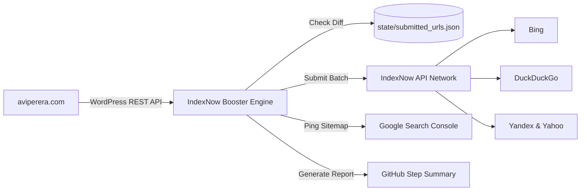

# 🚀 IndexNow Search Engine Traffic Booster

[](https://github.com/a-vip/indexnow-traffic-booster/actions/workflows/indexnow-ping.yml)
[](LICENSE)
[](https://python.org)

An autonomous GitHub Actions automation engine that supercharges search engine indexing and organic traffic for [aviperera.com](https://aviperera.com).

Whenever you publish new essays, research reports, or legal frameworks, this engine detects new URLs and instantly notifies **Bing, Yandex, DuckDuckGo, Yahoo, and Seznam** via the [IndexNow Protocol](https://www.indexnow.org/), bypassing the standard multi-week search bot crawling delays.

---

## ⚡ How It Works



1. **Autonomous Crawling**: Queries `https://aviperera.com/wp-json/wp/v2/posts` and `/pages` on a recurring schedule.
2. **Delta Detection**: Compares against `state/submitted_urls.json` to identify newly published and updated articles.
3. **Instant Broadcast**: Batches new URLs into an IndexNow payload and dispatches it in milliseconds.
4. **Google Ping**: Pings Google’s sitemap endpoint to alert Googlebot.
5. **Transparency Dashboard**: Posts a Markdown table of indexed articles to `$GITHUB_STEP_SUMMARY`.

---

## 🛠️ Configuration & GitHub Secrets

To activate live indexing, add these optional secrets in your repository settings:

| Secret Name | Description | Example |
| :--- | :--- | :--- |
| `INDEXNOW_KEY` | Your 32-character IndexNow API key | `4a8f9b2c1d3e4f5a6b7c8d9e0f1a2b3c` |
| `INDEXNOW_KEY_LOCATION` | (Optional) URL where `<key>.txt` is hosted | `https://aviperera.com/4a8f9b2c1d3e4f5a6b7c8d9e0f1a2b3c.txt` |
| `SITE_HOST` | Target domain | `aviperera.com` |

> [!NOTE]
> If `INDEXNOW_KEY` is omitted, the workflow automatically runs in **DRY-RUN / Simulation Mode** without failing, allowing you to preview discovered URLs in the Actions log.

---

## 💻 Local Usage

```bash
# Dry run simulation
python indexnow_engine.py --dry-run

# Force submit all site URLs
python indexnow_engine.py --force-all --key YOUR_KEY
```

---

## 📄 License

MIT © [Avi Perera](https://aviperera.com)
